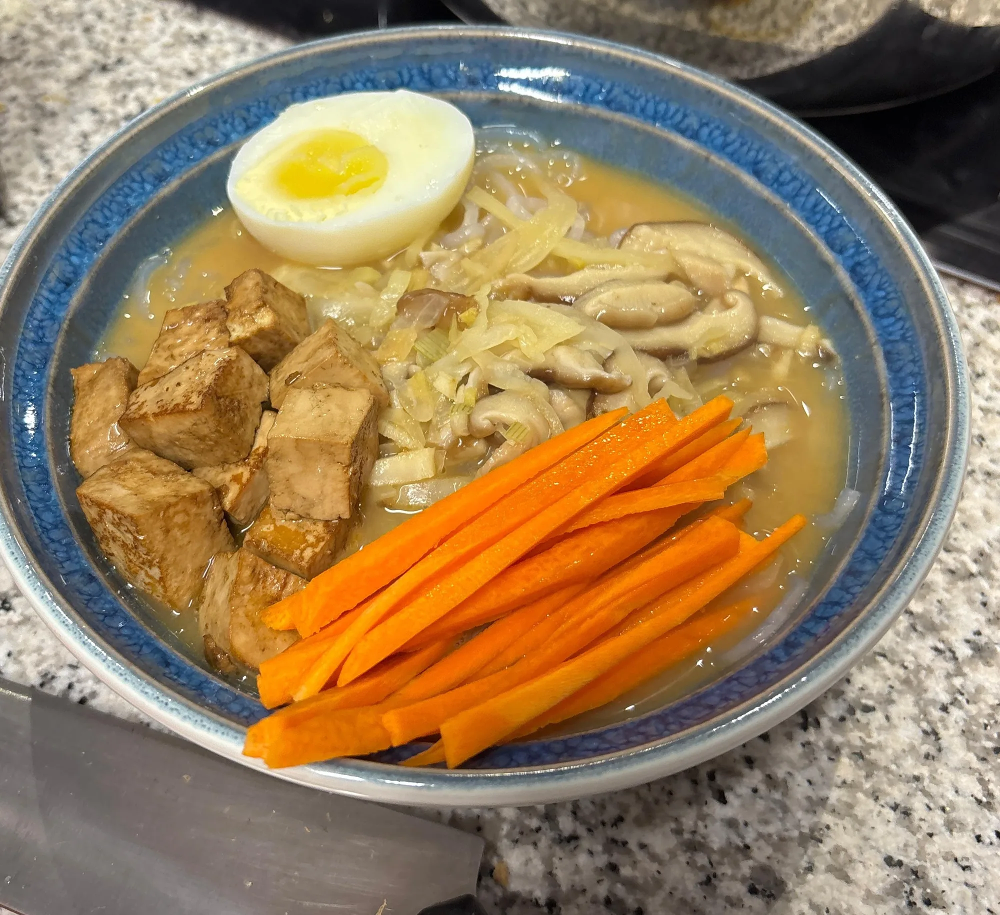

# Ramen de konjac

## Ingredients

### Per al brou cremós de ramen
- 2 l de brou de pollastre, de verdures baix en sal o de ramen ja fet
- 70 g de miso blanc (shiro miso)
- 80 g de crema de cacauet 100%
- 35 ml de salsa de soja baixa en sal
- 20 g de gingebre fresc
- 2 grans d'all
- 10 ml d'oli de sèsam torrat
- 10 ml d'oli d'oliva verge extra
- 15 ml de vinagre d'arròs

### Per als fideus i la guarnició
- 1 kg de fideus de konjac escorreguts
- 5 fulles grans de pak choi (col japonesa)
- 200 g de xampinyons o xiitakes
- 120 g de pastanaga
- 2 cebes tendres petites
- 6 ous (15 quarts per als tastos i 1 quart sobrant)
- 15 g de sèsam torrat
- 1 llima

## Procediment
1. Preparem les verdures. Rentem el pak choi i en separem les fulles. Laminem els bolets, tallem la pastanaga en juliana i piquem la part blanca de la ceba tendra. Reservem la part verda per a l'acabat.
2. Preparem el brou. Escalfem l'oli d'oliva i sofregim suaument l'all picat i el gingebre ratllat durant 1-2 minuts. Hi afegim els bolets, els saltem 3-4 minuts, hi incorporem el brou i ho coem 10 minuts a foc suau.
3. Incorporem el miso i el cacauet. Barregem el miso i la crema de cacauet en un bol amb un parell de cullerots de brou calent fins que quedi homogeni. Ho abboquem a l'olla i hi afegim la salsa de soja, el vinagre d'arròs i l'oli de sèsam. Escalfem sense fer bullir intensament. Tastem i ajustem de condiment.
4. Coem els ous. Els coem durant 10-11 minuts des que l'aigua bull, per obtenir el rovell quallat. Els refredem en aigua freda, els pelem i els tallem a quarts.
5. Coem breument les verdures. Afegim la pastanaga al brou durant uns 2-3 minuts. Escaldem les fulles de pak choi 30-60 segons, segons la mida, perquè mantinguin la textura i el color.
6. Preparem el konjac. L'escorrem i l'esbandim bé sota aigua corrent. L'escalfem segons les instruccions del fabricant; en general, n'hi ha prou amb 1-2 minuts en aigua bullent. L'escorrem abans de posar-lo al brou.
7. Muntem el plat. Distribuïm els fideus entre els recipients i hi afegim la pastanaga, els bolets i el pak choi. Ho cobrim amb el brou molt calent i acabem amb l'ou, la part verda de la ceba tendra, el sèsam torrat i unes gotes de llima.

## Notes
- Recepta feta el 20 d'octubre de 2026 amb l'Aleix, professor del curs de cuina saludable de Riudoms.
