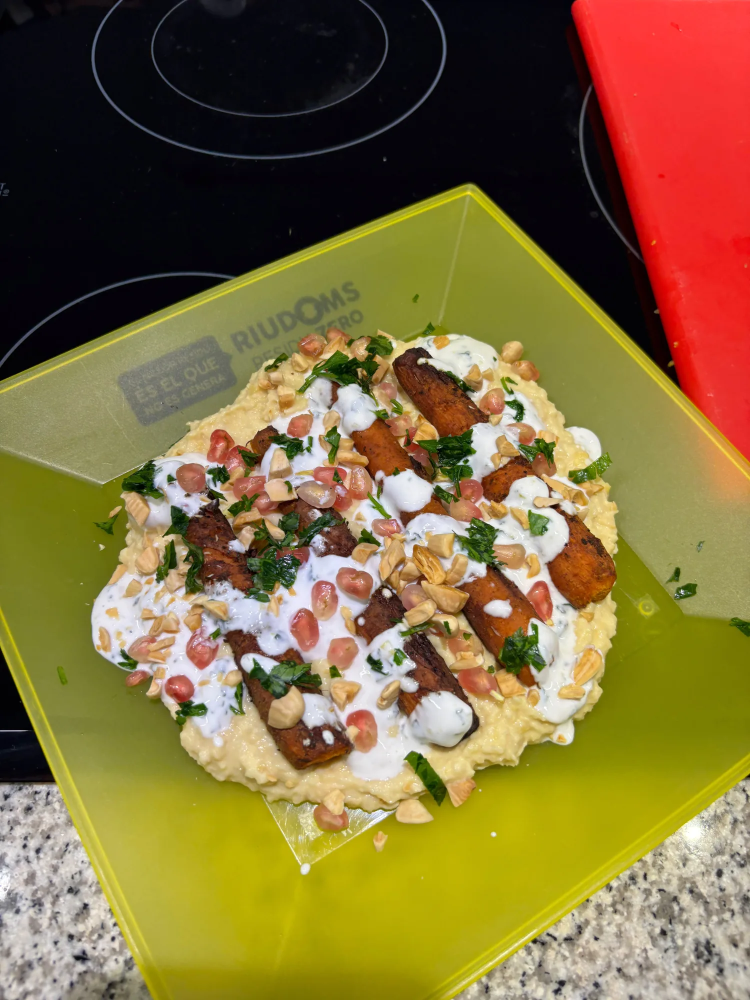
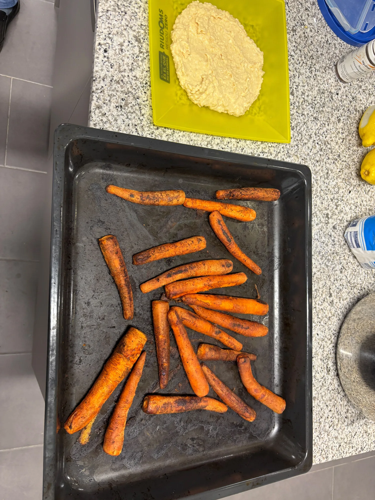
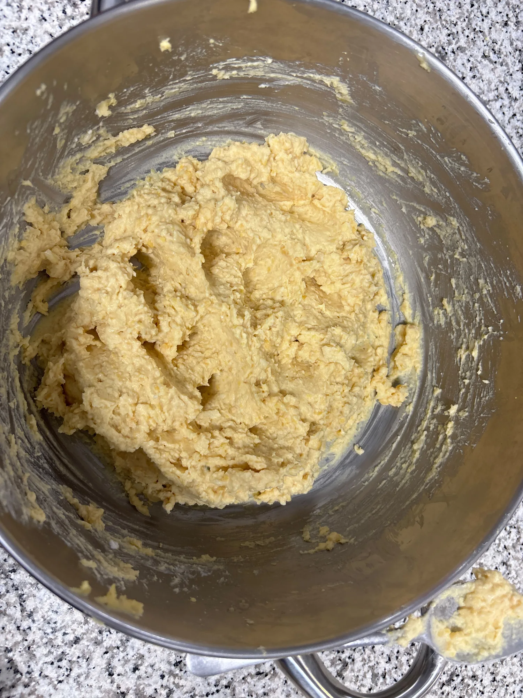

# Pastanagues rostides amb hummus cremós

## Ingredients

### Per a les pastanagues rostides
- 900 g de pastanagues fines
- 30 ml d'oli d'oliva verge extra
- 20 g de harissa
- 3 g de comí molt
- 3 g de pebre vermell fumat
- Sal i pebre negre

### Per a l'hummus cremós
- 500 g de cigrons cuits escorreguts
- 60 g de tahina
- 35 ml de suc de llimona
- 1 gra d'all petit
- 15 ml d'oli d'oliva verge extra
- 100–150 ml d'aigua molt freda
- Sal

### Per a la salsa de iogurt
- 200 g de iogurt grec natural sense sucre
- 15 ml de suc de llimona
- Ratlladura de ½ llimona
- 5 g de menta fresca
- Sal

### Per als acabats
- 60 g de festucs torrats sense sal
- 100 g de grans de magrana
- 10 g de julivert o coriandre fresc
- 10 ml d'oli d'oliva verge extra

## Estris
- Forn i safata de forn
- Batedora o processador d'aliments
- Ratllador
- Ganivet i taula de tallar
- Bols per barrejar

## Procediment
1. Escalfem el forn a 220 °C. Pelem les pastanagues i, si són gruixudes, les partim de llarg.
2. Les barregem amb l'oli, la harissa, el comí, el pebre vermell fumat, la sal i el pebre negre. Les repartim en una safata i les rostim 25–30 minuts, fins que siguin tendres i daurades. Les girem a mitja cocció.

   

3. Triturem els cigrons amb la tahina, el suc de llimona, l'all, l'oli i la sal. Afegim l'aigua freda a poc a poc fins a obtenir una crema fina, lleugera i untuosa.

   

4. Barregem el iogurt amb el suc i la ratlladura de llimona, la menta picada i un pessic de sal. El reservem a la nevera.

   

5. Piquem els festucs de manera irregular. Desgranem la magrana i piquem les herbes fresques.
6. Estenem una base generosa d'hummus en una safata. Hi posem les pastanagues calentes al damunt, afegim petites cullerades de salsa de iogurt i acabem amb els festucs, la magrana, les herbes i un fil d'oli.

## Recomanacions
- Tria pastanagues fines o talla-les en trossos de mida similar perquè es coguin alhora.
- El contrast entre la pastanaga calenta, l'hummus cremós, el iogurt fresc i els festucs cruixents és la clau del plat.
- La recepta del curs indica 5 racions / 15 tastets; el nombre de tastets depèn de la mida de la porció.

## Notes
- Recepta feta el 27 d'octubre de 2026 amb l'Aleix, professor del curs de cuina saludable de Riudoms.
- Per al taller: la pastanaga és rica en betacarotè, precursor de vitamina A; els cigrons aporten fibra, proteïna vegetal i hidrats de carboni complexos; la tahina i els festucs aporten greixos insaturats i minerals, i el iogurt natural aporta proteïnes i calci sense sucres afegits.
- El document del curs descriu aquest plat com a vegetarià i de cocció al forn.
