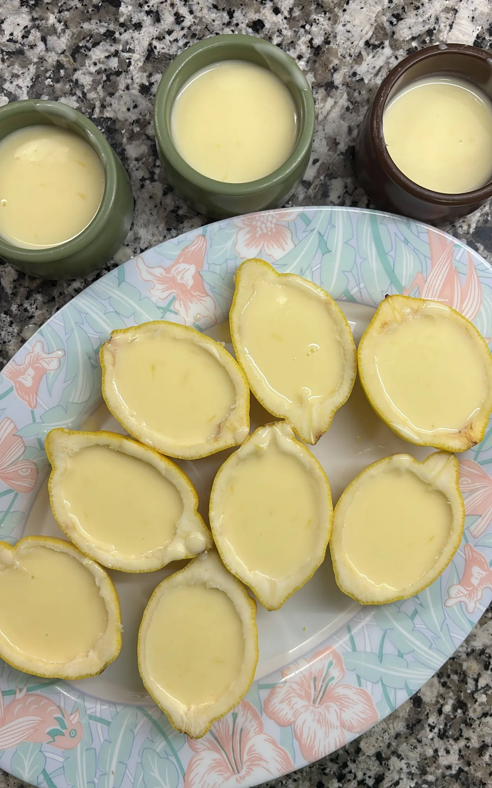
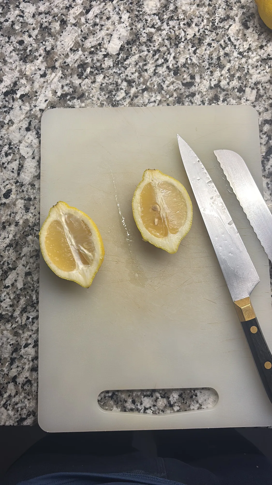
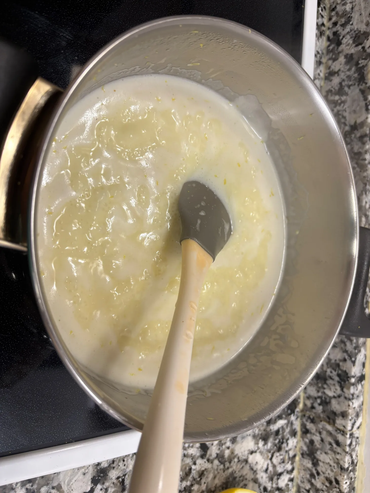
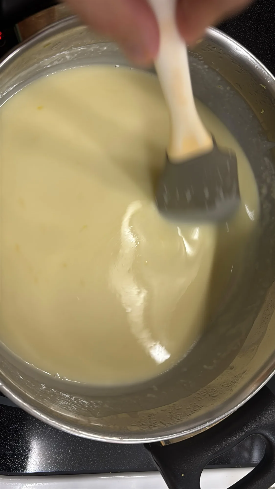
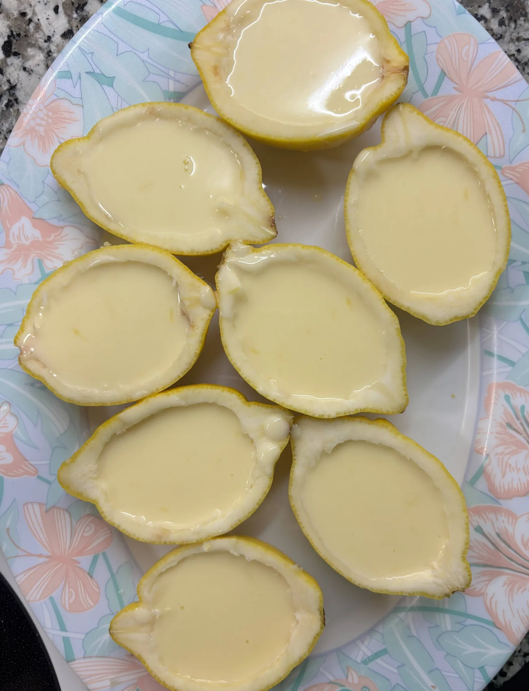
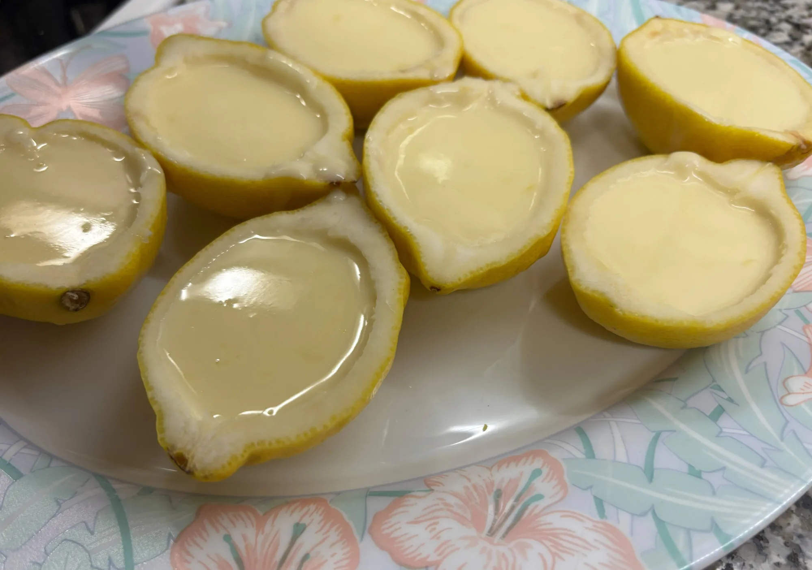

# Llimona brûlée

Una crema de llimona (estil *posset*) servida dins de la mateixa closca de la llimona, amb una crosta de sucre torrat com la d'una crema catalana.

## Ingredients
- 4 llimones (millor sense cera a la pell, perquè s'hi fa servir la ratlladura)
- 500 ml de nata líquida per muntar
- 120 g de sucre blanc
- Sucre moreno per a la crosta

## Estris
- Cassola
- Colador fi
- Ratllador
- Varetes
- Safata o motlle perquè les meitats de llimona queden estables
- Bufador de cuina

## Procediment
1. Renta les llimones. Parteix-ne 3 per la meitat a lo llarg i buida'n la polpa amb una cullera, sense trencar la closca: seran els recipients de les postres.

   

2. Passa la polpa per un colador fi i mesura uns 110 ml de suc. Reserva'l.
3. Ratlla la pell de la 4a llimona.
4. A la cassola, posa-hi la nata, el sucre blanc i la ratlladura de llimona. Porta-ho a ebullició suau i deixa-ho reduir lleugerament, remenant, fins que cobreixi el revers d'una cullera.

   

5. Fora del foc, incorpora-hi els 110 ml de suc de llimona mentre hi remenes amb les varetes, fins que quedi una crema fina i homogènia.

   

6. Omple les closques de llimona amb la crema i posa-les a la nevera un mínim de 6 hores o, millor, tota la nit.
7. Just abans de servir, cobreix cada meitat amb una capa prima de sucre moreno i crema'l amb el bufador fins que es caramel·litzi.
8. Serveix quan el sucre s'hagi endurit i faci crosta.

## Recomanacions
- El suc de llimona és el que fa quallar la nata (tècnica del *posset*): no te'l saltis ni el posis a bullir de nou.
- Fes una capa fina de sucre moreno: si és massa gruixuda, costa de torrar de manera uniforme i queda massa dolça.
- Si no tens bufador, pots fer servir el grill del forn ben fort, vigilant-los de molt a prop perquè no es cremi la closca.

## Notes
- Recepta inspirada en un reel d'Ed Cudlipp (@ed.cudlipp), cuinada a casa el 10 de novembre de 2026.
- S'ha fet servir nata del 35% de matèria grassa. Durant la cocció, la barreja bullia però no deixava capa a l'espàtula; s'hi va incorporar el suc fora del foc igualment.
- En aquesta preparació han sortit 8 meitats de llimona i 3 pots de crema (11 postres en total). El rendiment depèn de la mida de les llimones i dels recipients.
- Del procés se'n van fer fotografies: les llimones partides i la crema a la cassola, i les llimones ja omplertes abans del refredament i de caramel·litzar el sucre.

## Inspiració
- [Lemon brûlée, reel d'Ed Cudlipp a Instagram](https://www.instagram.com/reel/DZsXDPyJfak/)

## Galeria

