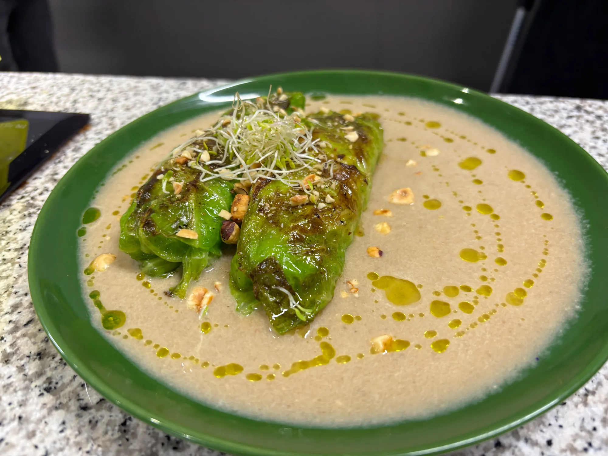

# Raviolis de col i pollastre a la catalana

Farcits de pollastre amb panses i avellanes, amb salsa cremosa de bolets i vi ranci sense nata.

## Ingredients

### Per als raviolis
- 15 porcions de fulla de col grosses i senceres (1 col arrissada gran i fulles de reserva)
- 600 g de contracuixa de pollastre picada
- 200 g de ceba neta
- 40 g de panses sense llavors
- 60 g d'avellanes torrades pelades
- 5 g d'all pelat
- 15 ml d'oli d'oliva per al farcit
- 10 ml d'oli d'oliva per marcar
- 4 g de sal i 0,5 g de pebre negre

### Per a la salsa i l'acabat
- 350 g de xampinyons o portobellos nets
- 300 g de ceba neta
- 60 ml de vi ranci
- 400 ml de brou de pollastre baix en sal
- 15 g d'avellanes torrades pelades
- 15 ml d'oli d'oliva verge extra
- 2 g de sal, només si cal
- 15 g d'avellanes torrades per decorar
- 5 g de julivert fresc

## Procediment
1. Comencem la salsa. Tallem els 300 g de ceba fina i la coem amb 15 ml d'oli a foc mitjà-baix fins que quedi ben daurada, uns 30-40 minuts. Si s'enganxa, hi afegim petites quantitats d'aigua en lloc de més oli. Mentrestant, preparem la col i el farcit.
2. Preparem la col. Separem les fulles sense trencar-les i les escaldem 2-4 minuts, fins que es puguin plegar. Les refredem, les escorrem i les eixuguem bé. Rebaixem el nervi gruixut amb un ganivet. Preparem 15 porcions prou grans per embolicar el farcit.
3. Fem el farcit. Sofregim els 200 g de ceba picada amb 15 ml d'oli fins que s'estovi. Hi afegim l'all picat i després el pollastre, la sal i el pebre. El coem completament, desfent els grumolls, sense ressecar-lo. Hi incorporem les panses picades i els 60 g d'avellanes picades a granet. Deixem que s'atemperi.
4. Acabem la salsa. Afegim els bolets tallats a la ceba daurada i els coem fins que perdin l'aigua i agafin color. Hi incorporem el vi ranci i el deixem reduir. Hi afegim 300 ml de brou i els 15 g d'avellanes; ho coem 10 minuts i ho triturem molt fi. Ho ajustem amb el brou restant perquè quedi cremós i fluid, sense textura de puré. Ho tastem abans de salar.
5. Formem i marquem. Repartim el farcit en 15 porcions. En posem una al centre de cada fulla, pleguem els costats i tanquem formant un paquet baix. Daurem els raviolis en una paella antiadherent amb els 10 ml d'oli, en tandes i amb el plec cap avall primer. Els girem amb una espàtula.
6. Acabem i presentem. Els posem dins la salsa i els escalfem suaument, tapats, uns 5-8 minuts, fins que el centre estigui ben calent. Hi afegim brou si la salsa s'espesseix massa. Els servim amb salsa per sota i una mica per damunt. Ho acabem amb els 15 g d'avellanes picades i el julivert, repartits entre totes les peces.

## Notes
- En surten 15 raviolis: 15 tastos o 7-8 entrants. Temps aproximat: 75-90 minuts.
- La cremositat prové de la ceba, els bolets i una petita quantitat d'avellana triturada; no cal nata ni mantega.
- Per a una versió amb ceps, substituïm una part dels bolets pel mateix pes de ceps. Piquem l'avellana de l'acabat a granet, no en pols.
- Al·lèrgens: avellanes i sulfits del vi ranci. Cal comprovar també els ingredients del brou.
- Recepta feta el 17 de novembre de 2026 amb l'Aleix, professor del curs de cuina saludable de Riudoms.
